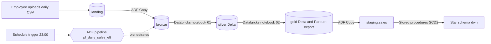
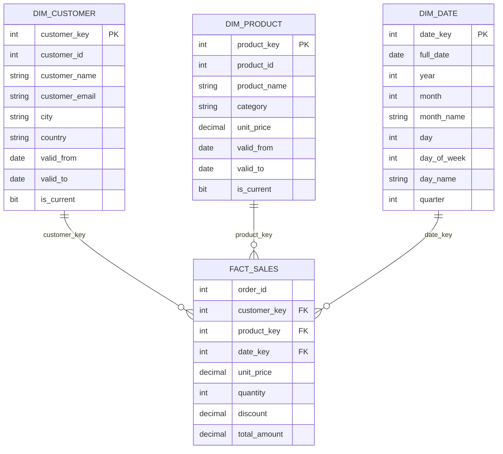

# Azure Sales ELT: Medallion Architecture with ADF, Databricks and Synapse

An end-to-end, production-style **ELT pipeline on Azure**. A daily sales CSV file is ingested into a data lake, cleaned and modelled through **bronze / silver / gold** layers with PySpark and Delta Lake, and loaded into a **star schema in Azure Synapse** with **SCD Type 2** history on the dimensions. The whole flow is orchestrated by Azure Data Factory and runs automatically every night.

---

## Table of contents

1. [Overview](#1-overview)
2. [How it works end to end](#2-how-it-works-end-to-end)
3. [Architecture](#3-architecture)
4. [Tech stack](#4-tech-stack)
5. [Repository structure](#5-repository-structure)
6. [Source data](#6-source-data)
7. [Implementation, step by step](#7-implementation-step-by-step)
8. [Design decisions](#8-design-decisions)
9. [Known limitations](#9-known-limitations)
10. [Possible improvements](#10-possible-improvements)
11. [How to reproduce](#11-how-to-reproduce)
12. [Cost control and cleanup](#12-cost-control-and-cleanup)

---

## 1. Overview

**Scenario.** Every day an employee drops a CSV file with that day's sales into a storage account. During the night, a pipeline picks the file up, keeps a raw copy, cleans the data, builds an analytics-ready table and loads it into a data warehouse. The warehouse keeps the full history of how customers and products changed over time (a customer moves to another city, a product changes price or category), so past sales stay attributed to the correct version of the customer or product.

**What this project demonstrates**

- ELT with the **medallion architecture** (bronze, silver, gold) on ADLS Gen2
- Orchestration with **Azure Data Factory**: parameterised datasets, file-existence check, conditional branches, notebook and stored procedure activities, schedule trigger with time-zone handling
- Data cleaning and modelling with **PySpark** and **Delta Lake** on **Azure Databricks** with **Unity Catalog**
- **Idempotent** loads: any day can be re-run without creating duplicates
- A **star schema** in a Synapse dedicated SQL pool with surrogate keys and **SCD2** dimensions, written in T-SQL stored procedures
- Realistic data quality problems (generated on purpose) and how each layer handles them

---

## 2. How it works end to end

1. **23:00 (Romania time)**: a schedule trigger starts the pipeline and passes `process_date`, the current day.
2. **Check**: ADF verifies that `sales_<process_date>.csv` exists in `landing`. If it does not, the pipeline fails immediately with an explicit message.
3. **Bronze**: ADF copies the file into `bronze/sales/YYYY/MM/DD/`.
4. **Silver**: a Databricks notebook reads the raw CSV, fixes types and quality issues, rejects invalid rows and writes the day into a partitioned Delta table.
5. **Gold**: a second notebook reads the day from silver, computes derived columns (`total_amount`, date parts), writes the day into a partitioned Delta table, and exports the day as one Parquet file.
6. **Staging**: ADF copies the Parquet file into `staging.sales` in Synapse (emptied before each load).
7. **Warehouse**: three stored procedures update `dim_customer` and `dim_product` (SCD2), then insert the day's rows into `fact_sales` with the correct surrogate keys.

Each step starts only if the previous one succeeded, so no layer ever processes missing or incomplete data.

| Layer | Format | Content | Rule |
|---|---|---|---|
| landing | CSV | the file as dropped by the employee | read-only input |
| bronze | CSV | exact copy, organised by date | never modified |
| silver | Delta (partitioned by `order_date`) | cleaned, typed, de-duplicated, validated rows | one trusted record per sale line |
| gold | Delta (partitioned by `order_date`) + daily Parquet export | analytics-ready, denormalised sales | source for the warehouse |
| staging (Synapse) | table | the current day only | emptied before each load |
| dwh (Synapse) | star schema | dimensions with history, facts | final model |

---

## 3. Architecture




### Pipeline `pl_daily_sales_elt`

```
check_file (Get Metadata: exists?)
        |
check_file_exists (If Condition)
   |- True : copy_landing_to_bronze
   '- False: fail_file_missing (Fail activity, error code FileNotFound)
        |
nb_bronze_to_silver   (Databricks notebook)
        |
nb_silver_to_gold     (Databricks notebook)
        |
copy_gold_to_staging  (Copy: Parquet -> Synapse staging.sales)
        |
sp_load_dim_customer  (stored procedure)
        |
sp_load_dim_product   (stored procedure)
        |
sp_load_fact_sales    (stored procedure)
```


### Star schema




---

## 4. Tech stack

| Area | Technology |
|---|---|
| Storage | Azure Data Lake Storage Gen2 (containers `landing`, `bronze`, `silver`, `gold`) |
| Orchestration | Azure Data Factory |
| Transformation | Azure Databricks (PySpark, Delta Lake, Unity Catalog) |
| Warehouse | Azure Synapse Analytics, dedicated SQL pool (DW100c) |
| Data generation | Mockaroo + Python (pandas, numpy) |
| Access | Managed identities, Databricks Access Connector, Unity Catalog external locations |

---

## 5. Repository structure

```
azure-sales-elt/
├── README.md
├── .gitignore
├── data/
│   ├── generator/          # generate_sales.py, customers.csv, products.csv
│   └── sample_input/       # sales_2026-11-01.csv, sales_2026-11-02.csv
├── adf/
│   ├── pipeline/           # pl_daily_sales_elt.json
│   ├── dataset/            # ds_landing_sales, ds_bronze_sales, ds_gold_export, ds_synapse_staging_sales
│   ├── linkedService/      # ls_adls, ls_databricks, ls_synapse
│   └── trigger/            # tr_daily_2300.json
├── databricks/
│   ├── 01_bronze_to_silver.py
│   └── 02_silver_to_gold.py
├── synapse/
│   ├── 01_create_schemas.sql
│   ├── 02_create_tables.sql
│   ├── 03_dim_date.sql
│   └── 04_stored_procedures.sql
└── docs/                   # diagrams and screenshots
```

Placeholders such as `<storage-account>` replace real resource names and must be set to your own values.

---

## 6. Source data

### How the files are generated

Random generators create new values on every export, which would make a customer look different on every row. To keep the data controlled and reproducible:

1. **Mockaroo** generates two small reference files: `customers.csv` (40 customers) and `products.csv` (25 products).
2. **`generate_sales.py`** combines them into two daily files, `sales_2026-11-01.csv` and `sales_2026-11-02.csv`, with a fixed random seed. Each file has **800 rows** (780 sales lines + 20 exact duplicates).

Columns: `order_id, order_date, customer_id, customer_name, customer_email, city, country, product_id, product_name, category, unit_price, quantity, discount`.

### Intentional data quality problems (handled in silver)

| Problem | Rows per file | Handling |
|---|---|---|
| Leading/trailing spaces in `customer_name` | 40 | `trim` on all columns |
| City in UPPER CASE | 40 | normalised to `Cluj-Napoca` style |
| City in lower case | 40 | normalised to `Cluj-Napoca` style |
| Missing `discount` | 20 | replaced with `0` |
| Missing `customer_email` | all rows of 4-5 customers | replaced with `unknown` |
| Negative `quantity` | 10 | row rejected |
| Negative `unit_price` | 5 | row rejected |
| `order_date` as `dd/MM/yyyy` | 15 | parsed with a second format |
| Exact duplicate rows | 20 | `dropDuplicates` |

Each file ends with **765 valid rows** after cleaning.

### Intentional changes between days (for SCD2)

| Entity | Change on day 2 |
|---|---|
| Customers 5, 12, 23 | move to another city |
| Customer 7 | had no email on day 1, has one on day 2 |
| Customers 36 to 40 | new customers (first appear on day 2) |
| Product 3 | price +15% |
| Product 8 | price -10% |
| Product 14 | category changes |

---

## 7. Implementation, step by step

### Step 1: Azure resources

**Purpose:** create the infrastructure everything else runs on.

- **Resource group** holding all resources (one delete removes everything at the end).
- **Storage account** with *Hierarchical namespace* enabled (ADLS Gen2) and containers `landing`, `bronze`, `silver`, `gold`, `synapse`, `unity`.
- **Azure Data Factory**.
- **Azure Databricks** workspace (Premium tier, required for Unity Catalog) with a small cluster and auto-termination.
- **Synapse workspace** with a **dedicated SQL pool** `dwh_sales` at the lowest performance level (DW100c).

### Step 2: Access between services

**Purpose:** services must be allowed to read and write each other's data without storing keys.

| Connection | How |
|---|---|
| ADF to storage | ADF managed identity with the *Storage Blob Data Contributor* role, `ls_adls` linked service |
| Databricks to storage | *Access Connector for Azure Databricks* (managed identity) with *Storage Blob Data Contributor* on the storage account, a Unity Catalog **storage credential**, and **external locations** for `bronze`, `silver`, `gold` |
| ADF to Databricks | `ls_databricks` linked service using a personal access token (stored encrypted by ADF, never in the repository) |
| ADF to Synapse | `ls_synapse` linked service, with the ADF identity created as a database user (`CREATE USER ... FROM EXTERNAL PROVIDER`) |


### Step 3: Bronze, ingestion with ADF

**Purpose:** keep an untouched copy of every file received, so any day can be reprocessed later.

**Parameterised datasets**

| Dataset | Type | Parameters |
|---|---|---|
| `ds_landing_sales` | ADLS Gen2, | `file_name` |
| `ds_bronze_sales` | ADLS Gen2, | `folder_path`, `file_name` |


**Pipeline parameter:** `process_date` (string, `yyyy-MM-dd`).

**File check.** A *Get Metadata* activity (`Exists`) is evaluated by an *If Condition*:

```
file name   : @concat('sales_', pipeline().parameters.process_date, '.csv')
condition   : @activity('check_file').output.exists
False branch: Fail activity "File sales_<date>.csv does not exist in landing"
```

The pipeline fails visibly when the employee has not uploaded the file, instead of silently reprocessing old data.

**Copy** (True branch) writes to a date-organised path:

```
folder_path : @concat('sales/', formatDateTime(pipeline().parameters.process_date, 'yyyy/MM/dd'))
result      : bronze/sales/2026/11/01/sales_2026-11-01.csv
```

### Step 4: Silver, cleaning (`01_bronze_to_silver.py`)

**Purpose:** turn raw data into trusted data.

1. **Read** the day's CSV with an **explicit schema**, all columns as strings, so nothing is lost or misinterpreted at read time.
2. **Deduplicate** exact duplicate rows.
3. **Trim** every text column and **normalise the city** (lower, hyphen to space, `initcap`, back to hyphen, so `CLUJ-NAPOCA` becomes `Cluj-Napoca`).
4. **Cast types**: `int` for keys and quantity, `decimal(10,2)` for price, `decimal(4,2)` for discount. Money is never stored as floating point.
5. **Handle missing values**: discount to `0`, email to `unknown` (keeps SCD2 comparisons free of `NULL`).
6. **Parse dates** with two formats via `coalesce` (`yyyy-MM-dd`, then `dd/MM/yyyy`).
7. **Reject invalid rows**: `quantity <= 0`, `unit_price <= 0`, or missing keys/date.
8. **Guards** that fail the notebook (and therefore the pipeline) on: zero valid rows, rows whose date differs from `process_date`, duplicate `(order_id, product_id)` keys.
9. **Write** to Delta, partitioned by `order_date`:

```python
(valid.write.format("delta")
      .mode("overwrite")
      .partitionBy("order_date")
      .option("replaceWhere", f"order_date = '{process_date}'")
      .save(silver_path))
```

`replaceWhere` replaces only the processed day's partition. Re-running a day produces no duplicates, a corrected file fully replaces the old rows, and other days are untouched.

Counts for each day: 800 read, 780 after deduplication, **765** after rejecting invalid rows.

### Step 5: Gold, analytics-ready table (`02_silver_to_gold.py`)

**Purpose:** a single denormalised table with measures and descriptive attributes, from which the warehouse is built.

1. Read **only the processed day** from silver (partition pruning); fail if it is empty.
2. Derived columns: `total_amount = round(unit_price * quantity * (1 - discount), 2)` as `decimal(12,2)`, plus `year`, `month`, `day`.
3. Select and order the final columns.
4. **Consistency check**: within one day, each customer must have a single name, city, country and email, and each product a single name, category and price. Otherwise SCD2 would create false versions, so the notebook fails.
5. Write to a **partitioned Delta table** with `replaceWhere` (same pattern as silver).
6. **Export the day as one Parquet file** (`coalesce(1)`, `overwrite`) to `gold/export/sales/YYYY/MM/DD/`, and compare its row count with the gold partition.

Why a Parquet export? ADF's Copy activity cannot read a Delta table (it would also see old file versions), so the day is published as plain Parquet files that Synapse can load.

### Step 6: Synapse model

**Purpose:** define the final structure, optimised for analytical queries.

Schemas: `staging` (temporary, one day) and `dwh` (final model).

| Table | Role | Notes |
|---|---|---|
| `staging.sales` | landing zone for the day's Parquet | `HEAP`, `ROUND_ROBIN`, no constraints, emptied on every load |
| `dwh.dim_customer` | who (SCD2) | surrogate key `IDENTITY`, `valid_from`, `valid_to`, `is_current`, `REPLICATE` |
| `dwh.dim_product` | what (SCD2) | same structure |
| `dwh.dim_date` | when | populated once, 2026-2030 (1826 days), key `YYYYMMDD`, `REPLICATE` |
| `dwh.fact_sales` | sales and measures | surrogate keys to dimensions plus the actual sale price, `ROUND_ROBIN` |

Design notes:

- A **surrogate key** identifies a *version* of a customer or product. Facts point to it, so history stays correct.
- Primary keys are declared `NONCLUSTERED ... NOT ENFORCED`: dedicated pools do not enforce them, so uniqueness is guaranteed by `IDENTITY` and by the load logic.
- The active version has `valid_to = '9999-12-31'` instead of `NULL`, so date-range filters stay simple.
- `fact_sales.unit_price` keeps the price actually charged, while `dim_product.unit_price` is the list price at that time.

The scripts in `synapse/` are re-runnable (`IF OBJECT_ID(...) IS NULL`).

### Step 7: Loading staging and building the star schema

**Staging.** An ADF Copy activity reads `gold/export/sales/YYYY/MM/DD/*.parquet` (wildcard, so only data files are loaded) into `staging.sales`, using the COPY command and a pre-copy script `TRUNCATE TABLE staging.sales`. Staging therefore always holds exactly one day.

**Stored procedures** (parameter `@process_date`), executed in this order, because facts need the surrogate keys created by the dimensions:

1. `dwh.usp_load_dim_customer`
2. `dwh.usp_load_dim_product`
3. `dwh.usp_load_fact_sales`

**SCD Type 2 logic** (identical for customers and products):

```sql
-- #src: one row per customer from today's staging data
-- 1. find customers whose attributes differ from their current version
INSERT INTO #changed
SELECT c.customer_id
FROM dwh.dim_customer c
JOIN #src s ON s.customer_id = c.customer_id
WHERE c.is_current = 1
  AND (c.customer_name <> s.customer_name OR c.customer_email <> s.customer_email
    OR c.city <> s.city OR c.country <> s.country);

-- 2. close the old versions
UPDATE dwh.dim_customer
SET valid_to = @process_date, is_current = 0
WHERE is_current = 1 AND customer_id IN (SELECT customer_id FROM #changed);

-- 3. insert new versions (changed customers + brand new customers)
INSERT INTO dwh.dim_customer (...)
SELECT s.customer_id, ..., @process_date, '9999-12-31', 1
FROM #src s
LEFT JOIN dwh.dim_customer c ON c.customer_id = s.customer_id AND c.is_current = 1
WHERE c.customer_id IS NULL;
```

Example: customer 5 moves from Iasi to Berlin on day 2.

| customer_key | customer_id | city | valid_from | valid_to | is_current |
|---|---|---|---|---|---|
| 5 | 5 | Iasi | 2026-11-01 | 2026-11-02 | 0 |
| 41 | 5 | Berlin | 2026-11-02 | 9999-12-31 | 1 |

Intervals are half-open, `[valid_from, valid_to)`, so a given date matches exactly one version.

**Fact load.** Inside one transaction the day's facts are deleted and re-inserted. For every staging row, the surrogate keys are found by joining each dimension on the business key **and** the version valid on the order date:

```sql
JOIN dwh.dim_customer c ON c.customer_id = s.customer_id
                       AND s.order_date >= c.valid_from AND s.order_date < c.valid_to
JOIN dwh.dim_product  p ON p.product_id  = s.product_id
                       AND s.order_date >= p.valid_from AND s.order_date < p.valid_to
```

`date_key` is computed as `YYYY*10000 + MM*100 + DD`, the same formula used to populate `dim_date`.

All procedures run inside `BEGIN TRY / BEGIN TRANSACTION / COMMIT`, with `ROLLBACK` and re-throw on error: either every step of a load succeeds or none does, so a dimension can never be left half-updated.

### Step 8: Orchestration and scheduling

- The **schedule trigger** `tr_daily_2300` runs every day at **23:00**, time zone set to Romania.
- It passes the processing date to the pipeline. The trigger time is UTC, so it is converted first:

```
@formatDateTime(convertFromUtc(trigger().scheduledTime, 'GTB Standard Time'), 'yyyy-MM-dd')
```

- The same `process_date` flows to `Get Metadata`, the Copy activities, the notebooks (base parameter, read with `dbutils.widgets`) and the stored procedures.
- Activities are chained with *On success*, so a failure stops everything downstream.
- A failed run can be restarted from the failed activity (transient problem) or fully (corrected input file).

### Step 9: Testing

| Test | Expected result |
|---|---|
| Day 1 | all dimension rows current; 765 facts |
| Day 2 | changed customers/products have two versions (old closed, new current); 765 more facts |
| Re-run of the last loaded day | no duplicates in silver, gold or facts; dimension counts unchanged |
| Missing file (`process_date` with no file) | pipeline fails at `fail_file_missing` with a clear message; no notebook runs |
| Dirty data | silver cleans or rejects each injected problem |
| Scheduled trigger | pipeline starts by itself and `process_date` equals the current date |

---

## 8. Design decisions

| Decision | Why |
|---|---|
| Explicit all-string read schema in silver | no silent type inference; conversion is controlled and failures become `NULL` that can be caught |
| `replaceWhere` on a date-partitioned Delta table instead of `MERGE` | the day is the unit of processing; reruns and corrections replace the whole day, including rows that disappeared from a corrected file |
| Processing is incremental, tables are cumulative | each run touches one day, but silver and gold keep the full clean history and can rebuild the warehouse |
| Parquet export of the day | ADF Copy cannot read Delta; staging receives only the new day |
| Incremental fact load, SCD2 dimensions | facts are immutable events and must not be re-sent; dimensions are small and need history |
| Surrogate keys | the same customer can have several rows (versions), so the business key is not unique |
| Deterministic file name plus existence check | a missing file fails loudly; "take the latest file" would silently re-process old data |
| Managed identity (Access Connector) instead of storage keys | no secrets to leak or rotate |
| Validation placed where a problem can appear | silver validates raw input; gold protects SCD2 consistency; Synapse relies on transactions for integrity |

---

## 9. Known limitations

- **Days must be loaded in chronological order.** Re-running an older day after a newer one has been loaded would create false dimension versions. Re-running the *latest* loaded day is safe.
- **No validation inside Synapse.** An empty or doubly loaded staging table, or a sale without a matching dimension version (dropped silently by the inner join), is not detected there. Protection against a doubly loaded staging table relies on the `TRUNCATE` in the Copy activity.
- **Dimensions are derived from sales.** A change to a customer or product is only detected when that entity has a sale. In a real system, dimensions usually come from a master data source.
- **A corrected file for an already loaded day** replaces the facts correctly, but may leave a zero-length dimension version.

---

## 10. Possible improvements

- Save rejected rows to a quarantine table with the rejection reason
- Source dimensions from a master data feed
- Alerts on pipeline failure (email or Teams)
- CI/CD for ADF and Databricks through Git integration
- A Power BI report on top of the star schema

---

## 11. How to reproduce

1. **Generate the data.** Create `customers.csv` (40 rows) and `products.csv` (25 rows) in Mockaroo, put them next to `data/generator/generate_sales.py` and run it (`pip install pandas numpy`). It writes the two daily CSV files.
2. **Create the Azure resources** from [Step 1](#step-1-azure-resources) and set the budget alert first.
3. **Configure access** from [Step 2](#step-2-access-between-services): roles, Access Connector, storage credential, external locations, linked services.
4. **Create the Synapse objects.** With the SQL pool online, run the scripts in `synapse/` in order. In `04_stored_procedures.sql`, run each procedure separately (select the block and run), because `CREATE PROCEDURE` must be alone in its batch.
5. **Import the notebooks** from `databricks/` and set the `storage` variable to your storage account name.
6. **Recreate the ADF objects** from the JSON files in `adf/` (or build them following Steps 3, 7 and 8) and replace placeholders (subscription, resource group, workspace, cluster) with your own.
7. **Upload the day-1 file** to `landing` and run the pipeline with `process_date = 2026-11-01`, then the day-2 file with `2026-11-02`.
8. **Verify** in Synapse:

```sql
SELECT 'dim_customer' AS tbl, COUNT(*) AS row_count, SUM(CAST(is_current AS INT)) AS active FROM dwh.dim_customer
UNION ALL SELECT 'dim_product', COUNT(*), SUM(CAST(is_current AS INT)) FROM dwh.dim_product
UNION ALL SELECT 'fact_sales', COUNT(*), NULL FROM dwh.fact_sales;
```

9. **Enable the trigger** only when the SQL pool will be online at run time.

> Never commit tokens, passwords or storage keys. Linked service JSON files must not contain secrets.

---

## 12. Cost control and cleanup

- The **dedicated SQL pool** is billed while it is running: pause it after every working session.
- The Databricks cluster auto-terminates after inactivity.
- Stop the trigger when the project is not in use, otherwise a night run fails if the pool is paused.
- When finished, delete the **resource group** to remove every resource at once, and revoke the Databricks access token.
